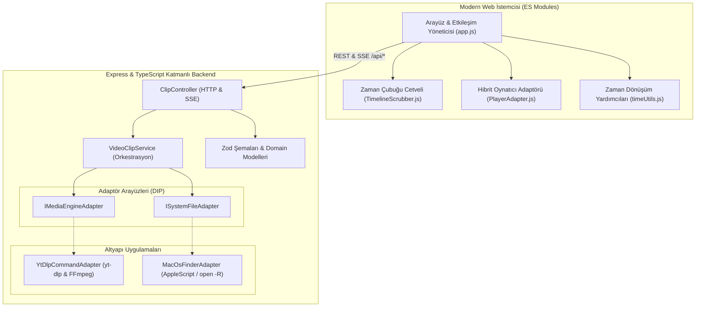

# 🎬 KesitAl — Görsel Zaman Çubuklu Video Kesit & Kırpma Aracı

<p align="center">
  
</p>

<p align="center">
  <b>Tüm videoyu indirmeden doğrudan seçtiğiniz saniyeleri kristal netliğinde kaydeden yüksek performanslı, görsel video kesme istasyonu.</b>
</p>

<p align="center">
  
  
  
  
  
  
</p>

---

## 🌍 Quick Summary (English)
**KesitAl** is a precision video clipping tool built with TypeScript, Node.js, and clean SOLID layered architecture. Unlike traditional downloaders that pull entire gigabyte-sized videos just to extract a short segment, KesitAl utilizes `yt-dlp`'s `--download-sections` and `--force-keyframes-at-cuts` flags alongside an interactive **QuickTime-style timeline scrubber**. It downloads only the exact byte ranges required within seconds, completely eliminating black frames or audio sync lags.

---

## ⚡ Neden KesitAl? (Farkı Ne?)

Geleneksel video indirme ve kırpma araçları genellikle iki büyük problem yaşatır:
1. **Gereksiz Bant Genişliği & Zaman Kaybı:** 2 saatlik bir podcast veya canlı yayından sadece 30 saniyelik bir kesit almak istediğinizde bile tüm 2-3 GB'lık videoyu indirmek zorunda bırakırlar.
2. **Siyah Kare / Donma Sorunu (Keyframe Glitch):** İndirilen videoyu standart FFmpeg ile kestiğinizde, kesim noktası anahtar kareye (I-frame) denk gelmediğinde videonun ilk 2-3 saniyesi donar veya siyah ekran verir.

### KesitAl Nasıl Çözer?
- 🚀 **Doğrudan Bölüm İndirme (`--download-sections`):** YouTube ve desteklenen video platformlarında HTTP byte-range istekleri kullanılır. 2 saatlik bir videonun yalnızca seçilen 20 saniyesi sunucudan çekilir (saniyeler içinde tamamlanır, kotanızı tüketmez).
- 🎯 **Sıfır Siyah Ekran Garantisi (`--force-keyframes-at-cuts`):** Kesim noktası anahtar kareye denk gelmiyorsa, kesitin başlangıç ve bitiş çerçeveleri akıllıca yeniden kodlanarak kusursuz bir geçiş oluşturulur.
- 🎚️ **QuickTime Tarzı Canlı Kırpma Cetveli (Timeline Scrubber):** Sarı sınır tutamaçları ile video üzerinde hassas aralık seçimi, canlı kare önizlemesi ve `±0.5s` mikro-ayar butonları.
- 🔄 **Hibrit Önizleme Motoru:** YouTube IFrame API ile genel MP4 akışlarını ayrıştıran hibrit oyuncu adaptörü sayesinde hiçbir CORS veya şifreleme engeline takılmaz.
- 🍏 **macOS Yerel Deneyimi:** Tek tıkla indirilen kesiti macOS Finder'da vurgulama (`open -R`) ve çift tıkla açılabilir macOS başlatıcısı (`KesitAl.command`).

---

## 🏛️ Mimari & Tasarım Prensipleri (Architecture)

Proje, katı **SOLID** prensipleri ve katmanlı temiz mimari (Clean Layered Architecture) gözetilerek inşa edilmiştir:



### Tasarım Deseni Vurguları:
- **Dependency Inversion (DIP):** `VideoClipService`, doğrudan CLI komutlarına veya işletim sistemine bağımlı değildir; `IMediaEngineAdapter` ve `ISystemFileAdapter` arayüzleri üzerinden gevşek bağlı (loosely coupled) çalışır.
- **Adapter Pattern:** `PlayerAdapter`, YouTube IFrame API ile HTML5 `<video>` elementini tek birleşik arayüz (`play`, `pause`, `seekTo`, `onTimeUpdate`) arkasında soyutlar.
- **Server-Sent Events (SSE):** Klip kesim ilerlemesi (`0% - 100%`) soket kütüphanelerine ihtiyaç duyulmadan hafif ve native SSE akışıyla istemciye gerçek zamanlı aktarılır.

---

## 🛠️ Sistem Gereksinimleri

KesitAl'ın video akışlarını çözümleyip yüksek hızda kırpabilmesi için sisteminizde **Node.js**, **yt-dlp** ve **FFmpeg** bulunmalıdır:

### macOS (Homebrew ile):
```bash
brew install yt-dlp ffmpeg
```

---

## 🚀 Hızlı Başlangıç & Kurulum

### 1. Depoyu Klonlayın ve Bağımlılıkları Kurun
```bash
git clone https://github.com/mihsanekinci/kesital.git
cd kesital
npm install
```

### 2. Uygulamayı Başlatın
```bash
npm start
```
Sunucu başlatıldığında `http://localhost:3847` adresi üzerinden arayüze erişebilir veya doğrudan `KesitAl.command` dosyasına çift tıklayabilirsiniz.

### 3. macOS Çift Tıkla Başlatıcı (`KesitAl.command`)
Proje kök dizinindeki `KesitAl.command` dosyasına çift tıklayarak uygulamayı terminal komutu yazmadan açabilirsiniz:
- Port 3847 zaten çalışıyorsa doğrudan tarayıcıyı açar.
- Çalışmıyorsa arka planda sunucuyu başlatıp hazır olduğunda tarayıcıyı yönlendirir.

> **İpucu (macOS Automator ile Dock Uygulamasına Dönüştürme):**
> 1. `Automator` uygulamasını açın ve **Yeni Belge ➔ Uygulama (Application)** seçin.
> 2. Soldan **Kabuk Betiğini Çalıştır (Run Shell Script)** eylemini ekleyin.
> 3. Kod olarak `open /Users/<KULLANICI_ADINIZ>/.../kesital/KesitAl.command` yazın.
> 4. `KesitAl.app` adıyla `Uygulamalar` klasörüne kaydedip dilediğiniz bir simge vererek Dock'unuza sabitleyebilirsiniz!

---

## 🧪 Test & Kalite Kapıları (Verification Gates)

Projede test güvencesi **Vitest** ve katı **ESLint** kuralları ile sağlanmaktadır.

```bash
# 1. TypeScript Tip Denetimi ve Derleme
npm run build

# 2. Kod Standartları ve Linter
npm run lint

# 3. Kapsamlı Birim ve Entegrasyon Testleri
npm test
```

Test Paketi:
- ✅ **Zod Doğrulama & Zaman Yardımcıları:** HH:MM:SS.mmm biçimlendirmeleri, YouTube ID ayrıştırıcıları, sınır değer testleri.
- ✅ **VideoClipService:** Asenkron iş kuyruğu takibi, hata yönetimi, mock adaptör doğrulamaları.
- ✅ **HTTP & SSE API Entegrasyonu:** `/api/videos/inspect`, `/api/clips/download`, `/api/clips/progress/:jobId`, `/api/system/reveal`.

---

## 📡 API Uç Noktaları

| Yöntem | Uç Nokta | Açıklama |
|---|---|---|
| `POST` | `/api/videos/inspect` | URL analizi yapar; video başlığı, süresi ve oynatılabilir kaynak bilgisini döner. |
| `POST` | `/api/clips/download` | Belirtilen `startTimeSeconds` ve `endTimeSeconds` aralığında indirme işini başlatır (`202 Accepted`). |
| `GET` | `/api/clips/jobs/:jobId` | İlgili işin anlık durumunu (`processing`, `completed`, `failed`) döner. |
| `GET` | `/api/clips/progress/:jobId` | Server-Sent Events (SSE) ile canlı yüzde ve durum akışı sağlar. |
| `POST` | `/api/system/reveal` | İndirilen MP4 dosyasını macOS Finder'da vurgular. |
| `GET` | `/api/health` | Sunucu sağlık kontrolü. |

---

## 📄 Lisans

Bu proje [MIT Lisansı](LICENSE) altında sunulmaktadır.

**Geliştirici:** Mehmet İhsan Ekinci  
*Açık kaynak, temiz mimari ve yüksek performanslı araçlar.*
